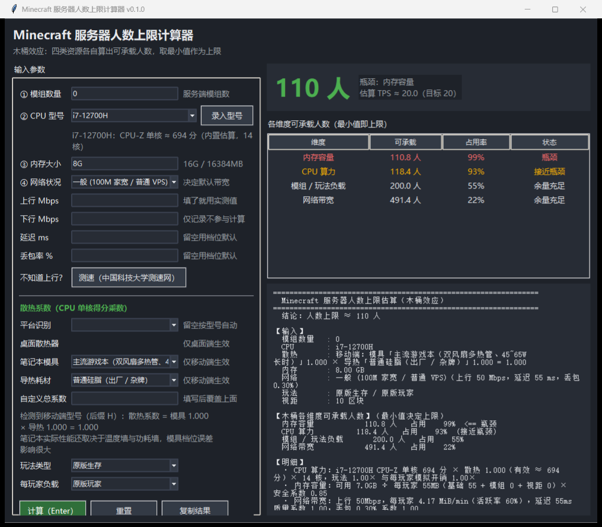

# Minecraft 服务器人数上限计算器

**输入模组数量 → CPU 型号 → 内存 → 网络状况，按木桶效应估算你的服务器能带多少人。**

[](LICENSE)
[](https://www.python.org/)
[](#1-立即运行)
[](mc_player_calc/selftest.py)

**中文 | [English](README.en.md)**

> **English speakers**: there's a quick-start in [`README.en.md`](README.en.md).
> The in-depth docs (coefficient provenance, calibration workflow) are Chinese-only for now.
> The tool's UI is Chinese; the calculation model itself is language-independent.

- 🚀 **零依赖**：纯 Python 标准库，不用 `pip install` 任何东西，双击启动器就能用
- 🖥 **三种界面，同一套内核**：本地网页版（推荐）· 桌面窗口 · 命令行，结论必然一致
- 🔒 **数据全在本地**：不联网、不上传、没有账号
- ❄️ **散热系数**：桌面按散热器档位；移动端按「模具 × 导热耗材」
- 🧩 **整合包一个包一套系数**：作者优化差别很大，所以按包名分别校准
- 📥 **反馈能反哺**：服主填的实测数据用来校准系数，可导出成给人 / 给 AI 读的文件
- 🧪 **自带测试**：内核自检 210+ 断言、网页接口 85+ 项、桌面窗口 8 场景



> 上图是桌面窗口版输入移动端 CPU（`i7-12700H`）时的界面：自动识别为笔记本平台，
> 展开「笔记本模具 + 导热耗材」，并在下方实时显示当前散热系数。
> 桌面 CPU 时这里只显示一个「桌面散热器」下拉，散热系数默认 1.000。

### ⚠ 先说清楚：这是估算工具，不是实测保证

CPU 维度的核心系数（基准承载人数、多核收益、容量幂）**目前是估算值，没有充分实测支撑**。
内存与网络维度有公开实测口径可核对。**请勿把输出当作服务器采购或容量承诺的依据。**

正因为如此，这个项目**正在收集服主的真实实测数据来替换估算系数**——
如果你有服务器实测数据，欢迎按 [第 14 节](#14-提交数据-报告问题) 提交，
工具里能一键导出给你我双方都能读的数据文件。

---

> **接手这个项目的人（或 AI）**：请先读 [`AGENTS.md`](AGENTS.md)（硬约束）
> 和 [`HANDOFF.md`](HANDOFF.md)（现状 / 决策理由 / 待办 / 已知缺口），
> 再看 [`FILE_MANIFEST.md`](FILE_MANIFEST.md)（每个文件干什么）。
> **要发布到 GitHub**：见 [`PUBLISH.md`](PUBLISH.md)（仓库名、简介、Topics、Release 文案全都写好了）。

---

## 1. 立即运行

### 本地网页版（默认推荐）

| 方式 | 操作 |
| --- | --- |
| 网页版（中文启动器，推荐） | 右键 `启动计算器.ps1` → 使用 PowerShell 运行 |
| 网页版（ASCII 兜底） | 双击 `启动计算器.cmd` |
| 网页版（命令行） | `python -m mc_player_calc.web` |
| 换端口 / 不开浏览器 | `python -m mc_player_calc.web --port 9000 --no-browser` |

启动后终端会打印地址（默认 <http://127.0.0.1:8765/>）并**自动打开浏览器**；
端口被占用时会自动换一个空闲端口。关闭终端窗口（或 Ctrl+C）即停止服务。

> 网页版只监听 `127.0.0.1`，**只在本机可访问**，页面上没有任何外部请求，
> 断网也能正常使用。想给局域网其它设备用可以加 `--host 0.0.0.0`（自行确认网络环境）。

### 桌面窗口版 / 命令行版

| 方式 | 操作 |
| --- | --- |
| 桌面窗口（tkinter） | 右键 `桌面窗口版.ps1` → 使用 PowerShell 运行；或 `python -m mc_player_calc.gui` |
| 命令行交互（依次问输入） | 右键 `命令行.ps1`；或 `python -m mc_player_calc.cli` |
| 命令行一步到位 | `python -m mc_player_calc --mods 30 --cpu "i5-12400" --ram 16G --net "良好"` |

### 辅助命令

| 方式 | 操作 |
| --- | --- |
| 框架自检（70+ 断言） | `python -m mc_player_calc.selftest` |
| 网页接口自检 | `python tools/web_smoketest.py` |
| 查看内置 CPU 库 | `python -m mc_player_calc --list-cpu` |
| 查看散热系数表 | `python -m mc_player_calc --list-cooling` |

> 未安装 Python 时，所有启动脚本会自动使用本机 DSH 自带的 Python 3.12 运行时。
> `.ps1` 启动器（推荐）：含中文提示，已带 UTF-8 BOM；`.cmd` 启动器为纯 ASCII 兜底版本。

## 2. 木桶效应是怎么算的

四个维度各自算出一个"可承载人数"（ceiling），**最终上限 = 四者最小值**，
与最小值相等（误差 0.5 人内）的维度全部标为「瓶颈」，落在 1.25 倍以内的标为「接近瓶颈」。

| 维度 | 公式（默认系数见 `config.py`） |
| --- | --- |
| **CPU 算力** | `45 × [(有效单核指数 × 核心数^0.75) ÷ (108 × 6^0.75)]^0.6 ÷ (模拟开销 × 玩法倍数)` |
| **内存容量** | `(内存 − 预留 1GB) × 0.85 ÷ [55 + 12×√(模组数×3) + 0.12×(视距−10)]`（MB/人） |
| **网络带宽** | `带宽Mbps × 60 ÷ (活跃时流量 ÷ 0.6) × (1−0.025) × 0.70 × 延迟系数 × 丢包系数` |
| **模组/玩法负载** | `200 ÷ [1 + 模组数 ÷ 100 × 玩法倍数]`（内容复杂度天花板） |

其中 **有效单核指数 = CPU-Z 单核分换算出的指数 × 散热系数**
（CPU-Z 换算见第 5 节，散热见第 3 节）；
「活跃时流量」(MiB/min) = `2.5 + 0.25×√(模组数×3)` 再叠加视距修正 `0.10×(视距−10)`；
CPU 维度的基准锚点是 `i5-12400（CPU-Z 单核 ≈ 700 / 6 核）→ 80 人`，收益按 0.6 次幂递减。

网络维度的质量系数：

- 延迟：超过 `120ms` 后按 `1 / (1 + 0.5 × (延迟/120 − 1))` 衰减
- 丢包：超过 `0.5%` 后按 `1 / (1 + 4 × (丢包 − 0.5))` 衰减

### 默认系数的来源（哪些有据、哪些是估算）

**这张表是整套工具最该被质疑的地方**，所以逐条标注出处：

| 系数 | 当前值 | 来源 | 可信度 |
| --- | --- | --- | --- |
| 每玩家内存 | 55MB + 模组 12MB×√ | 2GB 堆 ≈ 15 人、4GB ≈ 35 人原版；8GB 约带 25 人（80 模组） | 中（二手实测口径） |
| 每玩家流量 | 2.5 MiB/min | 活跃玩家跑图 50~80KB/s、站立 1~2KB/s，取活跃口径 | 中（二手实测口径） |
| 活跃率 | 0.6 | 公开实测按"60% 玩家在跑图"估算 | 中 |
| 每模组流量 | +0.25 MiB/min（√ 缩放） | 模组/科技服活跃玩家 60~120KB/s | 中 |
| **CPU 锚点** | **45 人 @ i5-12400** | **无实测支撑，纯估算**（原本写 80，用示例数据反推后下调） | **低 ← 最需要校准** |
| CPU 多核收益 α | 0.75 | 估算（MC 主线程受限，多核收益递减） | 低 |
| CPU 容量幂 | 0.6 | 估算（压缩硬件差距） | 低 |
| 模组天花板 | 200 人 @ 原版 | 估算（内容复杂度上限） | 低 |

也就是说：**内存 / 网络两个维度的数字有公开实测口径可以核对，CPU 维度的数字基本是我拍的**。
所以我提供了一个校准工具，把你和服主聊出来的真实数据直接反推成系数：

```bash
python -m mc_player_calc.calibrate --template          # 打印采集模板（直接发给服主）
python -m mc_player_calc.calibrate anchors.json         # 反推并生成报告
python -m mc_player_calc.calibrate anchors.json --write # 写出 params_override.json
```

采集口径必须统一，否则数据没法合并。**推荐口径：在线人数增长到 TPS 首次跌破 19.5 时的人数**，
并记录当时的人数、TPS、服务端类型/版本、view-distance、是否开预防性区块加载。
只有服主明确判断"瓶颈是 CPU"的数据才会被用于反推（其余自动跳过，报告里说明原因）。

参考：[SpigotMC 带宽讨论](https://www.spigotmc.org/threads/bandwidth-usage-and-connection-speed.309151/)、
[50 人 MC 服务器带宽实测口径](https://idctop.com/article/692477.html)。
这些都是**二手经验值**，最终应以真实压测数据为准（见第 5、7 节）。

## 3. 散热系数（桌面 / 笔记本）

**桌面 CPU 默认散热系数 = 1.000**，不影响原有结果；只有识别为**移动端 CPU** 时才展开
「笔记本模具 × 导热耗材」。

```
散热系数 = 模具系数 × 导热耗材系数        # 移动端
散热系数 = 散热器系数                     # 桌面端
有效单核得分 = 原始单核得分 × 散热系数     # 再进入 CPU 维度公式
```

### 平台识别规则（Intel / AMD 命名）

| 后缀 | 含义 | 典型型号 |
| --- | --- | --- |
| `H` / `HK` | 标压高性能 | i7-12700H、i9-14900HK |
| `HX` | 桌面级模具（可换 CPU） | i9-14900HX、R9 8945HX |
| `HS` | AMD 低功耗高性能 | R7 7840HS、R9 7940HS |
| `U` / `Y` | 低压轻薄 | i7-10510U、i5-10210U |
| `P` | 准标压 | i5-1240P、i7-1260P |
| `G1~G7` | Intel 核显本 | i5-1135G7 |
| — | Core Ultra 移动版 | Core Ultra 7 155H |
| 桌面后缀 `K` / `F` / `KF` / `X` / `X3D` / 无后缀 | 台式机 | i5-12400、i9-14900K、R7 7800X3D |

识别入口是 [cpu_data.py](mc_player_calc/cpu_data.py) 的 `is_mobile_name()`，也可以直接在界面上
强制指定平台（"平台识别"下拉），或写 `某移动U 8核` 这类含"移动/笔记本"字样的描述。

### 系数表（全部可在 [cooling.py](mc_player_calc/cooling.py) 里改）

**笔记本模具**（基准 = 主流游戏本 = 1.00，与中端台式风冷相当）

| 档位 | 系数 |
| --- | --- |
| 轻薄本 / 核显本（单风扇、15~28W） | 0.85 |
| 全能本 / 轻薄独显（双风扇、35~45W） | 0.92 |
| 主流游戏本（双风扇多热管、45~65W 长时） | 1.00 |
| 高端游戏本（均热板 / 三风扇、65~100W） | 1.05 |
| 移动工作站 / 厚砖本（100W+） | 1.10 |
| 迷你主机 / NUC / 掌机（受限模具） | 0.88 |

**导热耗材**（基准 = 普通硅脂 = 1.00）

| 档位 | 系数 |
| --- | --- |
| 普通硅脂（出厂 / 杂牌） | 1.00 |
| 高性能硅脂（信越 7921 / 暴力熊等） | 1.02 |
| 相变片 / 石墨烯贴片 | 1.03 |
| 液金导热（需专业维护） | 1.06 |
| 导热垫老化 / 3 年以上未维护 | 0.92 |

**桌面散热器**（基准 = 中端风冷 = 1.00）

| 档位 | 系数 |
| --- | --- |
| 被动散热 / 无风扇（迷你主机、NAS） | 0.88 |
| 原装散热器 / 老旧散热 | 0.95 |
| 中端风冷（4 热管单塔） | 1.00 |
| 高端风冷（双塔 / 6 热管以上） | 1.02 |
| 240 / 360 水冷 | 1.025 / 1.04 |

用法举例（同一个 i7-12700H）：

| 场景 | 散热系数 | 有效单核 | CPU 可承载 |
| --- | --- | --- | --- |
| 轻薄本 + 普通硅脂 | 0.850 | 93.5 | 107 人 |
| 全能本 + 普通硅脂 | 0.920 | 101.2 | 113 人 |
| 主流游戏本 + 普通硅脂 | 1.000 | 110.0 | 118 人 |
| 高端游戏本 + 高性能硅脂 | 1.071 | 117.8 | 123 人 |
| 移动工作站 + 液金 | 1.166 | 128.3 | 130 人 |

命令行等价写法：

```bash
python -m mc_player_calc --mods 20 --cpu "i7-12700H" --ram 16G \
  --chassis "轻薄本 / 核显本（单风扇、15~28W 限制）" --material "液金导热（需专业维护）"
python -m mc_player_calc --cpu "i5-12400" --radiator "被动散热 / 无风扇（迷你主机、NAS）"
python -m mc_player_calc --cpu "i7-12700H" --cooling 0.80     # 直接指定总系数
python -m mc_player_calc --list-cooling                        # 打印全部系数表
```

> 说明：模具筛选只是"推荐档位"的便利功能（例如 U 后缀只给轻薄本档），
> **你手动选的档位一定生效**，与后缀不符时只在提示里告知，不会覆盖你的选择。

## 4. 输入说明（写得很随意也能识别）

| 输入 | 可接受的写法 |
| --- | --- |
| 模组数量 | `30`、`约 150 个` |
| CPU | `i5-12400`、`i5 12400F`、`R7 5800X3D`、`5800X3D`、`7800X3D`、`i7-12700H`、`R7 7840HS`、`Core Ultra 9 285K`、`epyc 7542`、`E5-2680 v4`、`N100`；<br>库里没有时写 `某某U 12核` 也能按核心数估算，或自己录入（见第 5 节） |
| 内存 | `16G`、`32GB`、`16384MB`、`8`（裸数字按 GB）、`1T` |
| 网络状况 | 5 个档位（极差 / 较差 / 一般 / 良好 / 极佳），也可只写 `光纤`、`千兆`、`机房`；<br>再单独覆盖 `上行带宽` / `下行带宽` / `延迟` / `丢包率` |
| 带宽（自填实测） | `35`、`35.6`、`500 Mbps`、`1Gbps`；上行留空就用档位默认 |
| 散热（移动端） | 笔记本模具 + 导热耗材下拉，或"自定义总系数"直接填数字（如 `0.85`） |
| 散热（桌面端） | 散热器档位下拉，默认中端风冷 = 1.000 |
| 视距、玩法、每玩家负载 | 下拉选择（玩法与模拟开销会乘到 CPU 与模组维度上） |

## 5. CPU-Z 单核跑分 + 自定义 CPU 型号录入

### 两套标尺（别混用）

| 标尺 | 用途 | 例子 |
| --- | --- | --- |
| **CPU-Z 单核分** | 界面上显示、你自己录入时填的就是这个 | R5 5600 ≈ **662**、i5-12400 ≈ **700**、i9-14900K ≈ **950** |
| **内部指数** | 引擎公式里用的（基准 100） | R5 5600 = 100、i5-12400 = 108、i9-14900K = 132 |

两者按幂律互转（CPU-Z 的刻度本身是"压缩"过的，最强与最弱只差 2 倍左右）：

```
内部指数 = (CPU-Z 分)^2 ÷ 4382.4        # 4382.4 = 662² ÷ 100
CPU-Z 分 = (4382.4 × 内部指数)^(1/2)
```

标定参数在 [config.py](mc_player_calc/config.py) 的 `cpuz_reference_score` / `cpuz_reference_index` /
`cpuz_exponent`，改这一处即可（`DEFAULT_PARAMS.apply_cpuz_calibration()` 会自动同步给换算函数）。
界面上每个型号都会显示「CPU-Z 单核 ≈ xxx 分」，方便你跟自己实测的数字对照。

### 录入自己的型号

三端都有入口，数据存到工作目录的 **`custom_cpus.json`**，重启后自动加载：

| 界面 | 操作 |
| --- | --- |
| 网页版 | CPU 型号下方点开「➕ 录入自定义 CPU 型号」，填型号 / CPU-Z 单核分 / 核心数 / 平台，点「保存并选用」 |
| 桌面窗口 | CPU 型号右侧「录入型号」按钮，弹窗里填同样的字段，下方可查看与删除已录入项 |
| 命令行 | `python -m mc_player_calc --add-cpu "Ryzen 7 5800X3D 开PBO:690:8:desktop"` |

```bash
# 命令行的完整用法
python -m mc_player_calc --add-cpu "型号:CPU-Z单核分[:核心数[:desktop|mobile]]"
python -m mc_player_calc --list-custom-cpu     # 看已录入的
python -m mc_player_calc --remove-cpu "型号"    # 删掉
python -m mc_player_calc --cpu "5800X3D 开PBO" --mods 30 --ram 16G   # 直接用它算
```

录入时的规则：

- **CPU-Z 单核分必须是数字**，范围限制在 0~5000（防止手滑多打一位）
- 平台留空就按型号名自动识别；写了 `移动端` / `mobile` 或型号带 H/U/HS/HX 后缀就走笔记本散热
- 同名型号再次录入会**覆盖**（方便你先估一个值，测准了再改）
- 录入后会自动选用该型号并重新计算，提示里会显示 `CPU-Z 690 → 内部指数 108.6`
- 自定义型号优先于内置型号匹配（你特意录入的应该赢过内置的近似型号），
  并且支持模糊查询：`5800X3D 开PBO`、`5800x3d开pbo` 都能命中

`custom_cpus.json` 长这样，可以直接手工编辑：

```json
{
  "cpuz_calibration": { "ref_cpuz": 662.0, "ref_index": 100.0, "exponent": 2.0 },
  "cpus": [
    { "name": "Ryzen 7 5800X3D 开PBO", "cores": 8, "platform": "desktop",
      "cpuz_single": 690, "score": 108.63, "note": "自测" }
  ]
}
```

> `cpuz_single` 是你填的原始分，`score` 是换算后的内部指数（工具自动写回，方便核对）。
> 想换存放位置：设环境变量 `MC_CALC_CUSTOM_CPUS`，或用 `MC_CALC_NO_AUTOLOAD=1` 关掉自动加载。

## 6. 自填测速结果 + 中科大测速网按钮（上行算人数、下行只记录）

不知道上行带宽是多少时，页面/窗口上都有一个**「测速（中国科技大学测速网）」**按钮，
点一下会由**本地服务调起你的默认浏览器**打开 <https://test.ustc.edu.cn/>；测完把结果填回来即可。

三个界面都支持，行为一致：

| 界面 | 上行 | 下行 | 测速按钮 |
| --- | --- | --- | --- |
| 网页版 | 「上行 Mbps」输入框，填了就用实测值 | 「下行 Mbps」输入框，仅记录 | 调 `POST /api/open-url`，由 Python 侧 `webbrowser.open` 打开 |
| 桌面窗口 | 同上 | 同上 | 直接 `webbrowser.open` |
| 命令行 | `--bw 35.6` | `--download 300` | `python -m mc_player_calc.cli --speedtest` |

**口径说明（很重要）**：

- **只有上行参与人数计算**。服务器是给玩家发数据的，下行几乎无限，卡人的永远是上行。
- **下行只做记录与展示**（结果里会单列一行），改它不会改变人数结论——这一点有断言守着。
- 原有 5 个网络档位**全部保留**：上行留空就用档位默认，填了就以实测值为准。
- 测速网地址只允许白名单内（默认 `https://test.ustc.edu.cn/`），
  非 http(s) 或白名单外的地址一律 403 拒绝，避免这个接口被当成"任意 URL 打开器"。
  要换地址：改 `web.py` 的 `SPEEDTEST_URL`，或用环境变量 `MC_CALC_SPEEDTEST_URL` 覆盖。

```bash
# 命令行测速 + 用实测值算一遍
python -m mc_player_calc.cli --speedtest
python -m mc_player_calc --mods 30 --cpu "i5-12400" --ram 16G --bw 35.6 --download 300
```

## 7. 整合包：一个包一套系数

**为什么不能共用一套系数**：整合包作者对服务端的优化差别极大——有的做了区块加载与实体 tick
优化，400 个模组能带 40 人；有的几乎没优化，同样 400 个模组只带 18 人。
所以"科技包 = 1.1 倍负载"这种按类型分类的误差会很大。

做法：**按包名建立档案，每个包从自己的服主数据里校准**。

### 系数从哪来（优先级从高到低）

| 优先级 | 来源 | 说明 |
| --- | --- | --- |
| 1 | 该包的**校准值** | 由 ≥3 条该包的服主反馈数据反推得到，存 `modpack_profiles.json` |
| 2 | 该包的**预填值** | 你可以直接编辑档案文件手动填 |
| 3 | **兜底折算** | 基础 1.6 × 玩法类型 × 进度阶段（该包还没有任何数据时） |

兜底规则：

- 玩法类型：科技/自动化 1.10 · 魔法/探索 1.00 · 综合 1.15 · 生电/红石向 1.20 · 轻量/优化向 0.90
- 进度阶段：开荒期 0.85 · 中期 1.00 · 大后期/长期服 1.20

> 系数是**每模组的负载倍数**：**越大 = 越吃资源 = 能带的人越少**。
> 所以"优化差的包"最终会得到一个更大的系数。

### 怎么用

三种界面都是**自由文本输入包名**（不是下拉选择）：

| 界面 | 位置 |
| --- | --- |
| 网页版 | 玩法选「整合包」后出现「整合包名称」输入框，带已知包名的输入提示（datalist，可自由填别的） |
| 桌面窗口 | 计算区有「整合包名称」输入框，下方实时显示匹配到的系数与来源 |
| 命令行 | `--modpack "GTNH 2.7"`，或交互模式下会问 |

包名匹配很宽松：只比较字母数字与中文，先精确再双向包含。
所以 `GTNH 2.7`、`GTNH`、`gtnh27` 都能命中同一个档案。

```bash
python -m mc_player_calc --list-modpacks        # 看已建档案的包及其系数
python -m mc_player_calc --feedback-packs       # 按包分组汇总（看到每个包的建议系数）
python -m mc_player_calc --feedback-apply-packs # 样本 ≥3 条时写回档案
```

### 校准报告里 mods 瓶颈是"有效信息"

注意这里和 CPU 校准**相反**：CPU 校准时如果瓶颈是模组天花板，那条数据要跳过
（否则两个杠杆互相污染）；但**按包校准时，模组天花板正是我们要量的东西**——
人数被"这个包的内容复杂度"卡住，反推出的就是这个包真实的负载系数。
所以只有内存/网络瓶颈会被跳过。

## 8. 信息反馈收集系统（收集 → 汇总 → 反哺工具）

目标是让**服主填的数据**能真正回到计算里，而不是躺在表格里。整条链路：

```
服主填表（网页 / 桌面窗口 / 命令行）
        │  校验：必填项、数值范围、整合包扩字段
        ▼
  feedback.json  ──┬─► calibrate.py 反推 CPU 承载系数（锚点格式直接复用）
                   └─► 按玩法分组汇总 ──► behavior_multiplier.json
                                              │
                                              ▼
                                    工具的「玩法」列表自动带上真实系数
```

### 收集字段

| 字段 | 必填 | 说明 |
| --- | --- | --- |
| CPU 型号 | ✅ | 越精确越好 |
| CPU-Z 单核跑分 | 建议 | Bench → CPU Single Thread 的分数；**库里没这个型号时，靠它才能参与计算** |
| 活跃用户（同时在线） | ✅ | **口径：增长到 TPS 首次跌破 19.5 时的人数** |
| 区块视距 | ✅ | view-distance |
| TPS | 建议 | 与上面同一时刻的值 |
| 玩法 | ✅ | 原版 / 小游戏 / 插件 / 红石生电 / 模组 / 整合包 |
| 瓶颈判断 | 建议 | cpu / ram / network / mods / 不确定 |
| 整合包名称 | 选「整合包」时必填 | **手动输入**（如 `GTNH 2.7`、`ATM10`），不是选预设 |
| 作者优化状况 | 选填 | 良好 / 一般 / 几乎没优化 / 不确定——**同类型不同包差别很大** |
| MC 版本 | 选「整合包」时建议 | 1.21.x / 1.20.x / … |
| 模组数量 | 选「整合包」时建议 | 影响内存与负载估算 |
| 整合包玩法类型 | 选「整合包」时建议 | 科技自动化 / 魔法探索 / 综合 / 生电红石向 / 轻量优化 |
| 内存、服务端、进度阶段、备注 | 选填 | 便于回溯与分组 |

### 交付流程：服主填完 → 导出文件 → 发给 Agent 算系数

**推荐流程**（也是你提的那种用法）：

```
1. 服主填表（网页 / 桌面窗口 / 命令行）
2. 你点「导出给 Agent 的文件」→ 得到 feedback_agent.md
3. 把这个文件发给任何 Agent / 人或贴进对话
4. 对方按文件里的说明反推 CPU 系数并给出结论
5. 你拿到结论后本地复核：python -m mc_player_calc.calibrate feedback_agent.md
```

`feedback_agent.md` 是**自解释**的，里面按顺序包含：

- 任务说明（要反推 `ref_players`、要判断数据可信度）
- 已知参数表（`ref_players` / `alpha` / `E` / CPU-Z 标定，标明哪些待校准）
- 口径定义（活跃用户 = TPS 首次跌破 19.5 时的人数）
- 逐条数据表（含每条的反推结果，供对照）
- **不能用于反推的记录**（自动标出原因，供复核）
- 期望的输出格式（4 条要求）
- 末尾一个 ` ```json ` 代码块（机器可读，`calibrate.py` 能直接读同一份文件）

也就是说：**同一份文件既能给人/AI 看，也能给工具读**，不需要再转换格式。

### 校准报告会告诉你"错在哪儿"

数据攒起来之后，报告不只看 `ref_players`。它会把数据按 CPU 强弱分成三档比较：

- 强势 CPU 反推出的 `ref_players` **系统性更高** → 说明容量幂 `E` 偏小（把硬件差距压得太平），
  建议调大（如 0.6 → 0.8）
- **系统性更低** → `E` 偏大，建议调小
- 没有系统性差异 → `E` / `alpha` 大致合适，只按几何平均调 `ref_players`

> 这条判断很关键。我实测时就撞上了：一条 i5-12400（44 人）和一条 i9-13900K（36 人）的数据，
> 反推出来是 44.0 和 14.0，几何标准差 2.25。**i9 比 i5 强 2 倍多，却带得更少**——
> 这不是数据错，而是我的 `E=0.6` 把强弱差距压得太狠，导致强 CPU 反推出的锚点偏低。
> 有这个提示，你就知道该动哪个旋钮，而不是盲目改锚点。

### 三端入口

| 界面 | 操作 |
| --- | --- |
| 网页版 | 页面「信息反馈收集」面板：填表 → 提交；旁边有汇总 / 导出 / 应用按钮 |
| 桌面窗口 | 点「服主反馈」按钮，弹窗里填表，可看汇总与已收条数 |
| 命令行 | `python -m mc_player_calc --feedback`（交互问答） |

```bash
python -m mc_player_calc --feedback                    # 交互式录入一条
python -m mc_player_calc --feedback-list               # 看已收集的数据
python -m mc_player_calc --feedback-summary            # 汇总 + 建议系数
python -m mc_player_calc --feedback-export anchors     # 导出（json / csv / anchors）
python -m mc_player_calc --feedback-apply              # 写入玩法系数（样本 ≥3 条才生效）
```

### 汇总怎么算的，以及为什么可能不准

玩法倍数 = `反推出的基准人数 ÷ 实测人数`。反推前会按模型跑一遍，**只接受「CPU 算力确实是瓶颈」
的数据**：

- 瓶颈是内存 / 网络 → 人数受它们限制，估玩法倍数会得到荒谬值（实测中出现过 0.2 这种数），跳过
- 瓶颈只是模组天花板 → 这条属于「模组天花板」的校准素材，跳过，避免两个杠杆互相污染
- 反推倍数超出 0~8 → 认为不合理，跳过

结果按玩法分组取**中位数**（抗离群），并给出样本数与组内离散度。样本 <3 条时只显示建议、不应用。

> ⚠ 玩法倍数很敏感：同一条数据里把它设成 1.15 还是 1.6，反推结果会差 40%。
> 所以同一玩法至少攒 3 条、且服务端 / 视距 / 进度阶段尽量同质，再考虑点「应用」。

### 数据存在哪 / 隐私

- 全部数据只写到**你本机的** `feedback.json`，页面不会自动上传任何东西
- 要分享给别人（或汇总给作者）时点「导出」自己发出去：JSON（原始）/ CSV（表格）/
  anchors（直接喂给 `calibrate.py`）
- 应用系数后生成 `behavior_multiplier.json`，工具下次计算自动加载；删掉该文件即恢复内置值
- 环境变量：`MC_CALC_FEEDBACK`（数据文件位置）、`MC_CALC_BEHAVIOR`（覆盖文件位置）

## 9. 参数标定入口（给后续真实数据用）

打开 `mc_player_calc/config.py`，`Params` 里每个字段都有中文注释说明含义与单位。
例如你实测得到"i5-12400 + 16G + 30 模组，12 人时 TPS 掉到 17"，
就可以调整：

```python
p = Params(
    ram_per_player_base_mb=110.0,      # 实测每玩家内存比默认高
    cpu_reference_players=60.0,        # CPU 基准锚点（当前 45）上调
    cpu_capacity_exponent=0.5,         # 多核/单核收益更低
    net_duty_cycle=0.75,               # 你的服玩家更活跃
)
```

散热系数同理，改 `mc_player_calc/cooling.py` 的三个字典即可（数字随便你定）：

```python
LAPTOP_CHASSIS["主流游戏本（双风扇多热管、45~65W 长时）"] = 1.00   # 基准
LAPTOP_CHASSIS["轻薄本 / 核显本（单风扇、15~28W 限制）"] = 0.78   # 你实测更差
THERMAL_MATERIAL["液金导热（需专业维护）"] = 1.05
```

代码里调用 `calculate(CalcInput(...), params=p)` 即可；GUI 与 CLI 默认使用 `DEFAULT_PARAMS`
与界面上的散热档位，也可以用"自定义总系数"直接覆盖。

## 10. 本地网页版是怎么实现的

```
浏览器（原生 HTML/CSS/JS）                Python 本地服务（http.server）
┌──────────────────────────┐   HTTP    ┌───────────────────────────────┐
│ 表单 / 表格 / 明细        │ ────────► │ /api/options  选项（下拉框数据）│
│ 散热联动（CPU 一改就切换）│ ◄──────── │ /api/cooling  只算散热系数     │
│ 结果渲染、复制报告        │           │ /api/calc     跑完整木桶计算   │
│ 测速按钮 → 开默认浏览器   │           │ /api/open-url 白名单内开网址   │
└──────────────────────────┘           └───────────────┬───────────────┘
                                                       │ 复用同一套内核
                                        parser → engine → report
```

- **零依赖**：只用标准库 `http.server` + `json`，前端是原生 JS，没有 npm / 构建步骤
- **同一套内核**：网页、桌面窗口、命令行共用 `parser/engine/report`，结论必然一致
  （`tools/web_smoketest.py` 里就有一条"网页与内核结论一致"的断言）
- **只监听本机**：默认 `127.0.0.1`，端口被占用自动换；静态资源做了目录穿越防护；
  只有 `/api/open-url` 能在你这台机器上开浏览器，且仅限白名单网址
- **接口很简单**，你也可以直接拿它做二次开发：

```bash
curl http://127.0.0.1:8765/api/options
curl -X POST http://127.0.0.1:8765/api/calc \
  -H "Content-Type: application/json" \
  -d "{\"mod_count\":\"30\",\"cpu\":\"i5-12400\",\"ram\":\"16G\",\"bandwidth\":\"35.6\"}"
curl -X POST http://127.0.0.1:8765/api/open-url \
  -H "Content-Type: application/json" \
  -d "{\"url\":\"https://test.ustc.edu.cn/\"}"
curl http://127.0.0.1:8765/api/cpu/custom
curl -X POST http://127.0.0.1:8765/api/cpu/custom \
  -H "Content-Type: application/json" \
  -d "{\"action\":\"add\",\"name\":\"Ryzen 7 5800X3D 开PBO\",\"cpuz\":690,\"cores\":8}"
curl -X POST http://127.0.0.1:8765/api/feedback \
  -H "Content-Type: application/json" \
  -d "{\"cpu\":\"i9-14900K\",\"cpuz_single\":950,\"players\":24,\"view\":\"10\",\"tps\":19.2,\"playstyle\":\"整合包\",\"modpack_name\":\"ATM10\",\"mc_version\":\"1.21.x\",\"mods\":400,\"modpack_kind\":\"综合（科技+魔法+任务）\",\"bottleneck\":\"cpu\"}"
curl -X POST http://127.0.0.1:8765/api/feedback \
  -H "Content-Type: application/json" -d "{\"action\":\"export\",\"format\":\"anchors\"}"
curl -X POST http://127.0.0.1:8765/api/feedback \
  -H "Content-Type: application/json" -d "{\"action\":\"export\",\"format\":\"agent\"}"
```

## 11. 代码结构

```
mc_player_calc/
├─ config.py      # ★ 木桶四个维度的可调系数 + CPU-Z 标定参数
├─ cooling.py     # ★ 散热系数表（桌面散热器 / 笔记本模具 / 导热耗材）与后缀规则
├─ cpu_data.py    # ★ CPU 型号库 + CPU-Z↔指数换算 + 桌面/移动端识别 + 自定义型号存储与模糊匹配
├─ parser.py      # 把用户随手输入的字符串解析成结构化数值（含散热配置）
├─ engine.py      # 木桶效应计算内核（四个维度 + 散热衰减 + 瓶颈判定 + 优化建议）
├─ report.py      # 文本报告渲染（网页明细 / CLI 输出 / GUI 明细 / 复制到剪贴板）
├─ web.py         # ★ 本地网页服务（http.server + JSON 接口）
├─ web/           # ★ 网页前端：index.html + style.css + app.js
├─ gui.py         # tkinter 桌面窗口（含 CPU 录入弹窗；CPU 一改就自动切换散热控件）
├─ cli.py         # 命令行（带参数 / 交互问答 / --add-cpu / --feedback）
├─ calibrate.py   # ★ 用服主实测数据反推 CPU 承载系数（含采集模板）
├─ modpack.py     # ★ 整合包档案：一个包一套系数（校准值/预填值/兜底折算）
├─ feedback.py    # ★ 信息反馈收集：校验、本地存储、玩法系数与按包系数汇总
├─ reset.py       # 恢复默认：按类别清本地状态，先备份可整组撤销
└─ selftest.py    # 框架自检：解析、瓶颈、散热、CPU-Z、反馈共 160+ 断言
custom_cpus.json            # 你录入的 CPU 型号（自动生成，可直接编辑）
feedback.json               # 服主反馈数据（自动生成，可导出分享）
behavior_multiplier.json    # 由反馈汇总出的玩法系数（自动生成，删掉即回默认）
modpack_profiles.json        # 整合包档案：一个包一套系数（自动生成/可手改）
anchors.example.json        # 校准锚点格式示例（anchors.json 是你自己收集的数据）
启动计算器.ps1 / .cmd        # 本地网页版启动器（推荐入口）
桌面窗口版.ps1 / .cmd        # tkinter 桌面窗口启动器
命令行.ps1 / .cmd            # 命令行启动器
tools/web_smoketest.py      # 网页接口自测（真的起服务器打 HTTP）
tools/check_web_ids.py      # 前端静态检查（JS 引用的 id 是否都在 HTML 里）
tools/gui_smoketest.py      # 桌面窗口联动与无裁切自测
tools/capture_gui.py        # 开发辅助：抓一张窗口截图给文档用
docs/screenshot*.png        # 界面截图
```

## 12. 校准路线（含找服主合作的数据方案）

工具已经能用了，但**精度取决于系数**。按"性价比"排序，建议这样推进：

### 第 1 优先：校准 CPU 锚点（45 人这个数字）

这是全套系数里唯一没有实测支撑的（见第 2 节表格）。做法：

1. **定口径**：统一用「在线人数增长到 TPS 首次跌破 19.5 时的人数」作为承载上限，
   顺便记录当时的 TPS。口径不统一的数据没法合并。
2. **发入口**：现在有两条路——
   - 让服主用**网页版的反馈表**自己填（或者你把网页版开在局域网上让他填）
   - 或者用 `python -m mc_player_calc.calibrate --template` 打印 JSON 模板发给他
3. **收数据**：优先找**同一台机器的不同配置**、以及**同一配置的不同版本/服务端**，
   这样能把"CPU 影响"和"版本影响"分开。样本量建议 ≥8 条再改默认值。
4. **反推**：`python -m mc_player_calc --feedback-export anchors` 导出后
   `python -m mc_player_calc.calibrate anchors.json`，会逐条反推 + 汇总几何平均 +
   给出离散度（几何标准差，越接近 1 越一致）。
5. **改默认值**：把 `config.py` 的 `cpu_reference_players` 换掉；
   如果样本离散度大（>1.6），说明还有别的变量没控住（版本 / 优化参数 / 玩家分布），
   优先补数据而不是急着改系数。

### 第 2 优先：按包校准整合包系数

整合包作者的优化状况差别极大，所以**一个包一套系数**（见第 7 节）。做法：

```bash
python -m mc_player_calc --feedback-packs        # 看每个包的建议系数与离散度
python -m mc_player_calc --feedback-apply-packs  # 样本 ≥3 条时写回档案
python -m mc_player_calc --list-modpacks         # 确认档案
```

- 同一台机器上跑**同一个包的不同优化版本**（比如作者更新了服务端优化），是最干净的对照数据。
- 玩法倍数（非整合包）仍然是攒 3 条后 `--feedback-summary` + `--feedback-apply`。
  注意第 8 节那个敏感性提醒——**先校准 CPU 锚点，再改玩法倍数**，否则两者互相吸收误差。
- `mod_ceiling_vanilla`（当前 200 人 @ 原版）与每包系数是同一套杠杆：包系数校准好之后，
  它才真正决定整合包的承载上限。
- `ram_per_player_base_mb`（55MB）：用 `/spark heapsummary` 或 GC 日志，
  记录"人数增长时堆占用的斜率"，这个比 CPU 好测得多。

### 数据可以从哪儿来

| 来源 | 拿得到什么 | 成本 |
| --- | --- | --- |
| 自己用假人压测（Carpet `/player`、bots 插件） | 最干净的对照数据 | 低，但要一台机器 |
| 服主合作 | 真实负载、真实玩家分布 | 中，需要沟通与统一口径 |
| 公开的 spark / timings 报告 | TPS 与耗时分布 | 低，但往往缺硬件信息 |
| 服务端 benchmark 仓库（如 Paper 的压测结论） | 版本间相对差异 | 低，但只给相对值 |

> 如果服主不愿意填 JSON，**让他直接把 spark 报告或 `/tps` 截图发来也行**——
> 我可以在 `calibrate.py` 里加一个"从文本报告里抠字段"的解析器，降低采集门槛。

### 其余可选升级

- 磁盘 IOPS 维度、插件服（Spigot/Paper）与模组服（Forge/Fabric）的差异系数、
  各版本（1.12 / 1.16 / 1.20 / 1.21）的基准差异、笔记本温度墙/功耗墙的独立参数
  —— 这些都属于"再加一个木桶维度"，框架已经支持。
- 网页版若要长期自用，可在 `.ps1` 启动器里固定端口（如 `--port 8765`），
  以后直接收藏 `http://127.0.0.1:8765/`。

## 13. 本地状态与「恢复默认」

工具会往工作目录写几个文件。想回到出厂状态、或者把项目上传/分享给别人之前，
用「恢复默认」清掉自己的数据。

**默认先备份再删**（改名成 `<原名>.<时间戳>.bak`），所以这一步是**可撤销**的。

### 三类文件（恢复默认时区分对待）

| 类别 | 文件 | 删掉的后果 |
| --- | --- | --- |
| **用户数据** | `custom_cpus.json`、`feedback.json` | ★ 会失去你自己录入的型号与收集到的服主数据 |
| **校准产物** | `behavior_multiplier.json`、`modpack_profiles.json` | 回到内置默认系数（可以重新算出来） |
| **导出/草稿** | `anchors.json`、`feedback_agent.md`、`feedback.csv`、`feedback_export.json` | 无影响，需要时重新导出 |

### 怎么用

| 界面 | 位置 |
| --- | --- |
| 网页版 | 页面底部「本地状态 / 恢复默认」面板：可以先「预演一下」，再选择清除范围 |
| 桌面窗口 | 按钮行「恢复默认」，弹窗里勾选范围，可「撤销上一次」 |
| 命令行 | 见下表 |

```bash
python -m mc_player_calc --state                 # 先看清有哪些数据、里面有多少内容
python -m mc_player_calc --reset-data --dry-run  # 预演：只清用户数据
python -m mc_player_calc --reset-data            # 真清用户数据（保留校准产物）
python -m mc_player_calc --reset-all             # 清用户数据 + 校准产物
python -m mc_player_calc --reset-all --with-exports   # 连导出文件一起清
python -m mc_player_calc --list-backups          # 看可撤销的备份
python -m mc_player_calc --restore-backups all   # 整组撤销（也可传具体时间戳）
python -m mc_player_calc --clean-backups         # 确认不再需要撤销时，删掉备份
```

> 一次「恢复默认」碰到的多个文件共用**同一个时间戳**，所以撤销是按**整组**做的——
> 只还原一部分会留下"一半新一半旧"的不一致状态。

## 14. 提交数据 / 报告问题

如果你在 GitHub 上看到这个项目，欢迎把你的实测数据发出来用于校准。

**推荐流程**：工具里点「导出给 Agent 的文件」→ 得到 `feedback_agent.md` →
打开一个「提交服务器承载数据」issue，把文件内容贴进去（或作为附件上传）。

几个提醒：

- **提交前先扫一眼内容**。文件里是服主填的字段，正常情况下不含 IP、玩家昵称之类的东西，
  但请你自己确认一遍再公开。
- **口径统一才有用**：人数必须是「TPS 首次跌破 19.5 时」的在线人数。
  口径不一致的数据没法合并。
- **估算和你的实测有出入不是 bug**。CPU 维度的核心系数目前是估算值；
  你的实测数据正是用来把它换成真实值的。

## 15. 重要声明

- **CPU 维度的系数（基准承载人数、多核收益、容量幂）是估算值，没有实测支撑**；
  内存与网络维度的数字有公开二手实测口径可核对。散热系数里"主流游戏本 = 1.00"是相对基准。
- 内置 CPU 库的 `score` 是**估算指数**（界面显示成 CPU-Z 分便于对照），跟你的实测值可能有出入；
  **以你自己在 CPU-Z 里跑出来的单核分为准**——直接用「录入型号」覆盖同名型号即可。
- 整合包系数目前**全部是兜底折算值**（基础 1.6 × 玩法类型 × 进度阶段），
  一个包一套的真实值需要该包的服主数据才能填上。
- 计算结果**不能替代真实压测**。估算越大误差越大，建议先用假人压测校准 `config.py`
  与 `cooling.py`，再拿去给服主参考。

## 16. 许可与声明

本项目采用 **GNU 通用公共许可证第 3 版（GPL-3.0）**，全文见 [LICENSE](LICENSE)。

- [COPYRIGHT](COPYRIGHT) —— 项目声明与 GPLv3 第 7 节允许的附加条款
  （含"估算值不是实测保证"的说明、署名保留要求、修改版本标注要求）

**这意味着什么（说人话版）**：

| 你可以 | 你必须 |
| --- | --- |
| 自由使用、修改、再分发 | 分发时**保留版权声明与许可证** |
| 用于任何目的（含商业） | 分发修改版本时**标明你改过、并给出日期** |
| 收费分发 | 分发二进制/修改版时**提供完整源代码**（GPL 的传染性） |
| 自己私下改着用，不公开 | 这种情况**没有任何义务** |

**两个常见误解，顺便澄清**：

1. **GPL 不能强制别人回传数据给你。** 你在本机运行本程序产生的数据文件
   （`feedback.json` 等）**不属于本作品的一部分**，不受 GPL 传染。
   想鼓励数据回流，靠的是 README 里的邀请和社群习惯——见 [COPYRIGHT](COPYRIGHT) 第三节。
2. **GPL 只管"分发"，不管"使用"。** 你自己改一版放自己服务器上用、不发给别人，
   完全不需要公开任何东西。这也是为什么它对"服主自己用"没有阻碍。

本工具是估算工具，输出不是实测保证，请勿用作采购或容量承诺的依据。
